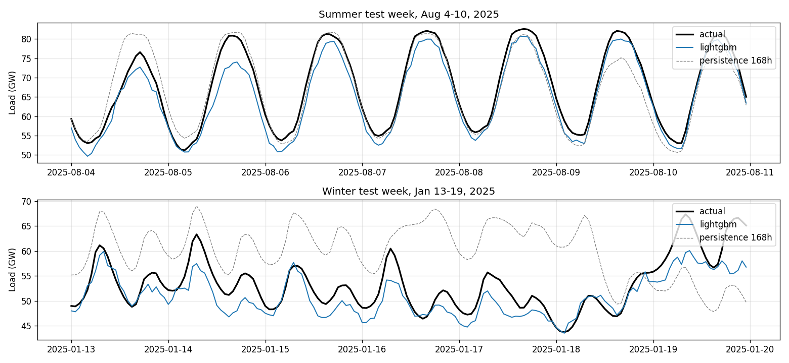
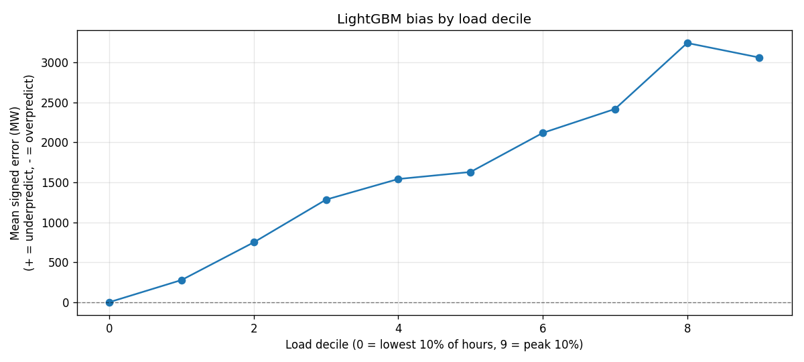

# ERCOT Load Forecasting

Hourly demand forecasting for ERCOT. Trained on 2024 and tested on 2025. Achieves a 3.64% MAPE with LightGBM on a
chronological holdout, beating lagged baselines.

## Results

| Model            | MAE (MW)  | MAPE (%) |
|------------------|-----------|----------|
| persistence_168h | 4,750     | 8.65     |
| persistence_24h  | 2,517     | 4.54     |
| **LightGBM**     | **2,106** | **3.64** |

Actual vs. predicted plot, one summer week and one winter week.



## Repository Structure

```bash
├── data
│   ├── processed       # CSV files used for training
│   └── raw             # ERCOT load data
├── notebooks           # exploratory data analysis
├── reports             # plots
└── src
    ├── load_ercot.py   # combine hourly ERCOT data
    ├── weather.py      # pull hourly weather data from Open-Meteo
    ├── merge.py        # join load and weather data
    ├── features.py     # build CSV used to train model
    └── train.py        # train LightGBM model and output stats
```

## Reproducing

```bash
pip install -r requirements.txt
python src/load_ercot.py
python src/weather.py
python src/merge.py
python src/features.py
python src/train.py
```

## Approach

Two years of hourly ERCOT system load (2024-2025) merged with hourly weather data from Dallas, Houston, and
San Antonio. Train on the year 2024 and test on 2025. Uses a chronological holdout and not a random split since the task
is forecasting the future from the past.

Features:
- **Time:** hour, day of week, month, with sin/cos encodings; weekend and US holiday flags; `days_since_start` as a time trend feature.
- **Weather (Dallas):** cooling and heating degree days, humidity, and dewpoint. Houston and San Antonio went unused as their temps correlate at r > 0.9 with Dallas.
- **Lags:** ERCOT load 24h and 168h ago.

Model: LightGBM regressor with 500 trees and no tuning.

## Findings

The test week plot suggested the model underpredicts peaks which is often due to boosting with
squared error pulling toward the conditional mean. However, plotting mean signed error by load decile showed the
underprediction is present at every level rather than exclusively at peaks.



This signaled a year-over-year shift. Comparing the mean loads between 2024 and 2025 confirms this. The 2025 mean load is **6.1%** above the 2024 mean load 
(+3,198 MW). ERCOT demand grew between the training and test years, consistent with reported growth in Texas grid demand.

I added a `days_since_start` feature to help the model learn the trend. It came out to roughly 1% of the total feature
importance but moved MAPE by only 0.05 percentage points. This is inherent to tree ensemble models since they cannot
extrapolate past values from training. Every 2025 row has a `days_since_start` value the model never observed in 2024,
so it is routed to whichever leaf contained the latest 2024 values and predicts it as if it were still late December 2024.
The trend feature helps within 2024 patterns but still does not project 2025's higher demand.

A linear model with the same trend features would extrapolate fine, but it would miss the non-linear patterns that
trees capture, such as how temperature, hour, and season collectively drive demand. A hybrid would be the best solution.

## Limitations and Future Work

- **Distribution shift not fully resolved.** Fixing it would require a hybrid model that fits the growth trend with a linear component and the residuals with a tree.
- **Houston and San Antonio weather unused.** Multi-city weather data might slightly improve performance despite high temperature correlation.
- **No hyperparameter tuning.** A quick search over `num_leaves`, `learning_rate`, and `min_child_samples` would likely yield slight MAPE improvement.
- **Fixed 24h horizon.** Only 24 hour ahead is supported. Forecasting further out would require feature changes.

## Data Sources
- ERCOT Native Load (hourly): [ERCOT](https://www.ercot.com/)
- Weather: [Open-Meteo Historical API](https://open-meteo.com/)